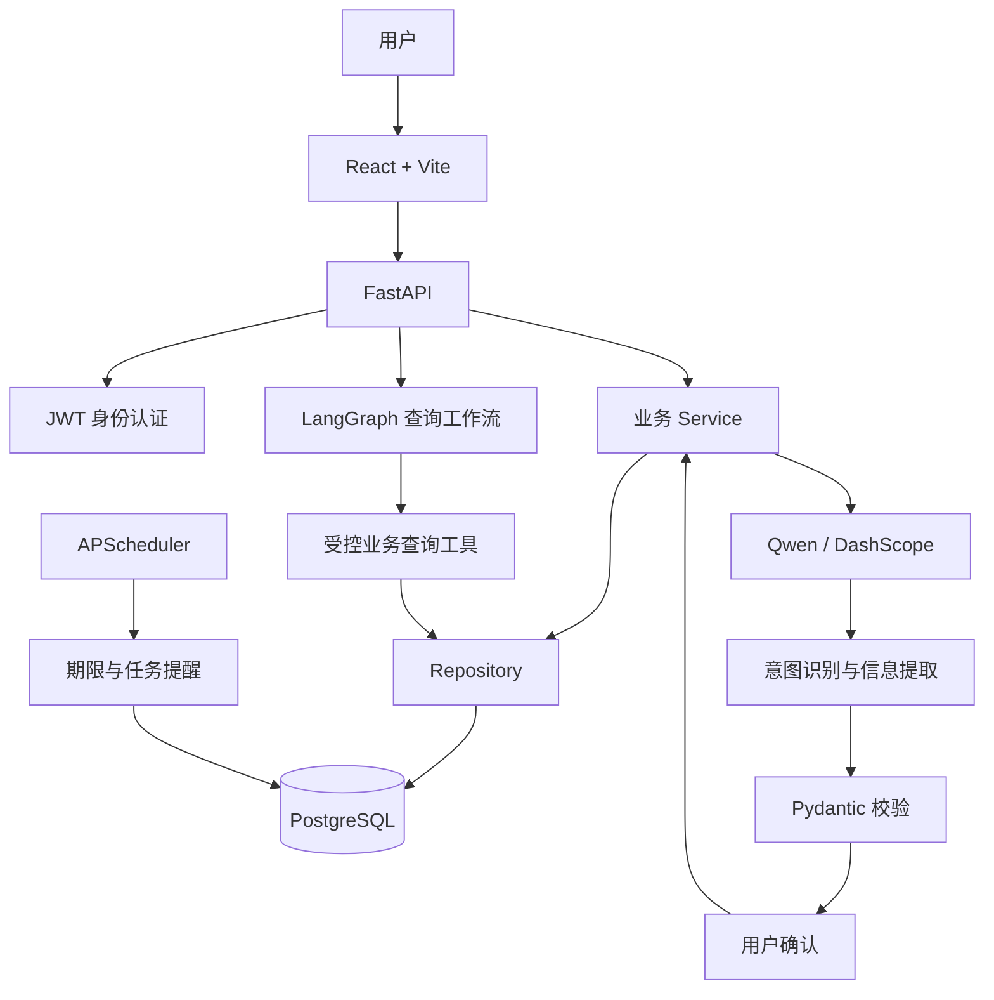

# 小事后援（Little Aftercare）

> 一个面向个人购物售后场景的 AI 辅助管理应用。  
> 帮助用户管理商品档案、购物凭证、售后期限和待办任务，并通过 AI 降低购物售后信息整理与处理成本。

## 1. 项目介绍

购物后的订单信息、退货期限、保修日期和购物凭证通常分散在不同平台、聊天记录和截图中，容易遗忘重要的售后时间。

**小事后援**围绕购物后的管理场景，提供商品档案、售后记录、购物凭证、任务提醒和 AI 辅助能力。

项目不是单纯的 AI 聊天 Demo，而是一个以真实业务数据和业务操作为核心的应用。

## 2. 核心功能

### 2.1 用户认证与个人中心

- 用户注册、登录和退出登录。
- 使用 JWT 进行身份认证。
- 页面刷新后恢复登录状态。
- 后端根据当前登录用户进行数据隔离。
- 个人资料管理。

### 2.2 售后记录管理

- 创建、查看、编辑和删除售后记录。
- 记录商品名称、购买平台、购买日期、退货期限、保修期限和备注。
- 支持关键词搜索、状态筛选、期限筛选、排序和分页。
- 展示即将到期和已经过期的售后事项。

### 2.3 AI 一句话整理

用户可以通过自然语言描述购买信息，例如：

```text
昨天在京东买了无线耳机，七天内可以退，保修一年。
```

处理流程：

```text
自然语言输入
    ↓
意图识别
    ↓
AI 提取结构化字段
    ↓
Pydantic Schema 校验
    ↓
前端展示候选记录
    ↓
用户确认或修改
    ↓
保存正式售后记录
```

AI 提取结果不会直接写入正式业务数据，必须经过用户确认。

### 2.4 商品档案

- 商品档案新增、查询、编辑和删除。
- 记录商品名称、品牌、型号、分类、购买价格、购买日期和购买渠道。
- 支持商品搜索、分类筛选、排序和分页。
- 商品可以关联售后记录和购物凭证。

### 2.5 购物凭证

- 上传购物凭证文件。
- 支持 JPG、JPEG、PNG、WEBP 和 PDF 格式。
- 对文件扩展名、MIME 类型、实际内容和大小进行校验。
- 支持凭证列表、预览、下载和删除。
- 支持关联商品。
- 通过当前登录用户身份控制凭证访问权限。

### 2.6 任务中心与通知

- 创建和管理个人任务。
- 支持待处理、进行中、已完成和已取消状态。
- 支持任务优先级、计划时间和提醒时间。
- 支持任务搜索、筛选和分页。
- 售后期限可联动生成系统任务。
- 任务通知与售后通知统一展示。
- 支持通知已读操作。

### 2.7 AI 自然语言业务查询（开发中）

计划通过 LangGraph 构建只读业务查询工作流，让用户使用自然语言查询商品、售后记录和任务。

预期流程：

```text
用户自然语言问题
    ↓
LangGraph Agent
    ↓
识别查询意图
    ↓
选择受控业务工具
    ↓
Pydantic 参数校验
    ↓
Repository 查询
    ↓
返回结构化结果
    ↓
LLM 组织自然语言回答
```

安全设计：

- LLM 不直接执行原始 SQL。
- 查询工具只开放明确的业务操作。
- `user_id` 由服务端当前登录用户上下文注入。
- 查询参数通过 Schema 限制。
- 复用现有 Repository，避免重复实现数据库查询逻辑。

## 3. 技术栈

| 模块 | 技术 |
|---|---|
| 后端 API | Python、FastAPI |
| 数据校验 | Pydantic |
| ORM | SQLAlchemy |
| 数据库 | PostgreSQL |
| 数据库迁移 | Alembic |
| 用户认证 | JWT |
| 前端 | React、Vite |
| AI 模型接入 | Qwen、DashScope 兼容接口 |
| AI 应用框架 | LangChain、LangGraph |
| AI 能力 | Prompt Engineering、结构化信息提取、Tool Calling、RAG 基础实践 |
| 定时任务 | APScheduler |
| 工程化 | Git、GitHub、Docker 基础实践 |

## 4. 系统架构



## 5. 工程化设计

### 5.1 分层架构

```text
API Router
    ↓
Service
    ↓
Repository
    ↓
Database
```

- Router：处理 HTTP 请求、参数和依赖。
- Service：组织业务逻辑。
- Repository：负责数据库查询与写入。
- Schema：定义请求校验和响应结构。
- ORM Model：定义数据库表结构。

### 5.2 用户数据隔离

使用 JWT 识别当前登录用户，后端从认证上下文获取用户身份。

业务查询和数据写入均需要结合当前用户身份进行权限控制，不能信任前端或 LLM 提供的用户 ID。

### 5.3 数据库迁移

使用 Alembic 管理数据库结构变更：

```text
修改 ORM Model
    ↓
生成 Migration
    ↓
审查迁移文件
    ↓
执行 upgrade head
```

### 5.4 AI 输出安全

AI 信息提取采用：

```text
模型输出
    ↓
JSON 解析
    ↓
Pydantic Schema 校验
    ↓
前端展示候选信息
    ↓
用户确认
    ↓
保存正式记录
```

### 5.5 文件安全

购物凭证上传时检查：

- 文件扩展名；
- MIME 类型；
- 文件实际内容特征；
- 文件大小；
- 保存文件名随机化；
- 删除和访问时的存储路径校验；
- 当前用户的数据访问权限。

### 5.6 日志与请求追踪

通过 Trace ID 关联 HTTP 请求和模型调用日志，帮助定位接口异常、模型调用耗时和业务问题。

## 6. 项目目录

```text
little-aftercare/
├── app/
│   ├── core/               # 配置、依赖、日志和请求上下文
│   ├── db/                 # ORM、数据库与 Repository
│   ├── schemas/            # Pydantic 请求与响应模型
│   ├── services/           # 业务服务与 AI 处理逻辑
│   ├── tools/              # Agent 可调用的业务工具
│   ├── graphs/             # LangGraph 工作流
│   ├── middleware/         # 请求中间件
│   ├── chat_service.py     # 聊天与 AI 业务入口
│   └── llm_client.py       # 大模型客户端
├── frontend/
│   ├── src/
│   │   ├── api/            # 前端 API 模块
│   │   ├── pages/          # 页面与认证上下文
│   │   ├── styles/         # 页面级样式
│   │   ├── App.jsx         # 应用主入口
│   │   └── styles.css      # 全局设计系统
│   └── package.json
├── alembic/                # 数据库迁移
├── evals/                  # AI 评测样本
├── scripts/                # 辅助脚本
├── logs/                   # 本地运行日志
├── main.py                 # 后端启动入口
└── README.md
```

## 7. 本地运行

### 7.1 环境要求

- Python
- Node.js 与 npm
- PostgreSQL
- Docker Desktop / Docker Compose（按项目数据库配置使用）
- 可用的 DashScope API Key

### 7.2 环境变量

在项目根目录创建 `.env`，按项目当前配置填写：

```env
DASHSCOPE_API_KEY=你的模型服务API密钥
DASHSCOPE_BASE_URL=https://dashscope.aliyuncs.com/compatible-mode/v1

POSTGRES_USER=aftercare_app
POSTGRES_PASSWORD=本地数据库密码
POSTGRES_DB=little_aftercare
POSTGRES_HOST=127.0.0.1
POSTGRES_PORT=5433
```

模型名称及其他配置以 `app/core/config.py` 中的 Settings 定义为准。

### 7.3 启动数据库

```powershell
docker compose up -d
```

### 7.4 启动后端

```powershell
.venv\Scripts\activate
alembic upgrade head
uvicorn main:app --reload
```

后端接口文档：

```text
http://127.0.0.1:8000/docs
```

### 7.5 启动前端

```powershell
cd frontend
npm install
npm run dev
```

如需修改后端地址，可配置前端环境变量：

```env
VITE_API_BASE_URL=http://127.0.0.1:8000
```

## 8. 项目开发进度

| 阶段 | 内容 | 状态 |
|---|---|---|
| P0 | 后端基础架构、数据库、认证、售后 CRUD、AI 提取确认闭环 | 已完成 |
| P1 | 前端主界面、商品档案、购物凭证、任务中心、通知中心 | 基础功能已完成 |
| P2 | LangGraph 自然语言查询、AI 商品与凭证识别、AI 售后管家 | 开发中 |
| P3 | 自动化测试、部署、性能验证、项目文档和作品集打磨 | 待完善 |

### 当前重点

1. 完成 LangGraph 自然语言业务查询的真实接口闭环。
2. 完善查询工具参数校验、用户隔离和异常处理。
3. 开发 AI 商品与购物凭证识别。
4. 开发 AI 售后管家 Agent。
5. 补齐自动化测试和部署流程。

## 9. 项目亮点

1. **真实业务闭环**：围绕商品、购物凭证、售后期限和任务提醒组织功能，而不是单纯的聊天页面。
2. **AI 安全写入流程**：采用结构化提取、Schema 校验和人工确认，避免模型直接修改正式业务数据。
3. **用户数据隔离**：使用 JWT 认证，并在服务端执行用户权限校验。
4. **受控 Agent 工具调用**：自然语言查询通过业务工具访问数据库，不开放任意 SQL 执行能力。
5. **工程化实践**：使用分层架构、Repository、Alembic、统一 API 请求处理和请求日志追踪。
6. **前后端完整交互**：React 前端覆盖售后、商品、凭证、任务、通知和个人中心等业务页面。

---

> 项目仍在持续开发中。当前优先完善 AI 自然语言查询闭环，再推进商品凭证识别、售后管家 Agent 和部署测试。