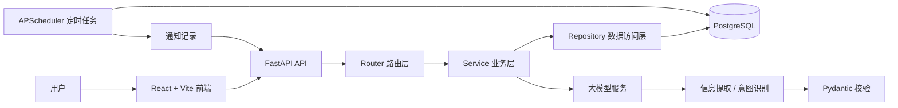

# 小事后援

> 一个面向个人购物售后场景的 AI 辅助管理应用。
> 帮助用户记录商品购买信息、管理退货与保修期限，并通过 AI 将自然语言整理为待确认的售后记录。

## 1. 项目背景

购物后的退货期限、保修日期、订单信息往往分散在购物平台、聊天记录和截图中，用户容易错过售后处理时间。

“小事后援”希望解决的问题是：

- 用户可以手动记录购买与售后信息；
- 用户可以用一句自然语言快速创建候选记录；
- 系统展示即将到期和已经过期的事项；
- 系统定时生成站内提醒；
- 用户可在前端查看提醒、标记已读并进入对应记录详情。

## 2. 核心功能

### 售后记录管理

- 创建、查看、编辑、删除售后记录；
- 记录商品名称、购买平台、购买日期、退货期限、保修期限、备注与处理状态；
- 使用 `session_id` 实现演示阶段的数据隔离；
- 支持按全部、未完成、已完成、即将到期、已过期筛选记录。

### AI 一句话整理

用户输入：

```text
昨天在京东买了无线耳机，七天内可以退，保修一年。
```

系统流程：

```text
自然语言输入
→ 意图识别
→ AI 提取结构化字段
→ Pydantic 校验
→ 前端展示待确认候选记录
→ 用户补充或修改
→ 保存正式售后记录
```

AI 不直接写入正式表，必须经过用户确认，避免模型幻觉或日期理解错误直接污染业务数据。

### 售后期限与提醒

- 查询未来 7 天内即将到期的退货或保修事项；
- 查询已经过期的事项；
- 展示期限总览；
- 使用 APScheduler 定时扫描到期事项；
- 生成站内提醒；
- 使用数据库唯一约束避免重复生成提醒；
- 前端铃铛显示未读数量和未读状态；
- 用户可标记提醒已读，并跳转查看对应记录。

## 3. 系统架构



## 4. 技术栈

| 模块 | 技术 |
|---|---|
| 后端 API | FastAPI |
| 数据校验 | Pydantic |
| ORM | SQLAlchemy |
| 数据库 | PostgreSQL |
| 数据库迁移 | Alembic |
| 定时任务 | APScheduler |
| 前端 | React + Vite |
| AI 模型接入 | OpenAI SDK 兼容接口 |
| AI 评测 | 自建 JSON 评测集与 Python 评测脚本 |
| 日志追踪 | Trace ID、ContextVar、RotatingFileHandler |

## 5. 工程化设计

### 数据库迁移

使用 Alembic 管理数据库结构变更：

```text
修改 ORM Model
→ 生成 Alembic migration
→ 审查迁移文件
→ 执行 upgrade head
```

避免依赖 `create_all()` 在不同环境中自动建表。

### 提醒幂等性

同一条售后记录在同一天不能生成重复提醒。

数据库使用唯一约束：

```text
record_id + deadline_type + deadline + remind_on
```

插入时使用 PostgreSQL 的冲突忽略机制，保证定时任务重复运行也不会重复提醒。

### 事务处理

数据库写操作遵循：

```text
db.add()
→ db.flush()
→ db.commit()
```

出现异常时：

```text
db.rollback()
→ raise
```

最终通过：

```text
db.close()
```

释放数据库连接。

### AI 输出安全

AI 提取结果不直接入库：

```text
模型输出 JSON
→ JSON 解析
→ Pydantic Schema 校验
→ 前端候选信息确认
→ 写入正式售后记录
```

对于缺失字段、日期歧义或模型输出格式异常，系统要求用户确认或重试。

### AI 评测

项目包含基础评测样本，覆盖：

- 完整信息；
- 缺失字段；
- 数字与订单号干扰；
- 日期歧义；
- 防止字段幻觉；
- 口语表达；
- 提示注入。

评测输出指标包括：

```text
样本通过率
字段准确率
missing_fields Precision
missing_fields Recall
missing_fields F1
```

### 请求链路追踪

每个 HTTP 请求都会生成唯一 `trace_id`：

```text
HTTP 请求开始
→ 写入 ContextVar
→ AI 模型调用读取同一个 trace_id
→ 记录模型耗时与输出长度
→ HTTP 请求结束
```

通过 `trace_id` 可以关联接口请求日志与模型调用日志，便于排查性能与异常问题。

## 6. 项目目录

```text
app/
├── core/               # 配置、依赖注入、日志、请求上下文
├── db/                 # ORM、Repository、数据库接口
├── middleware/         # 请求日志中间件
├── schemas/            # Pydantic 请求与响应模型
├── services/           # AI 提取、意图识别、期限业务逻辑
├── llm_client.py       # 大模型客户端封装
├── reminder_scheduler.py
└── chat_service.py

alembic/                # 数据库迁移脚本
evals/                  # AI 提取评测样本与实验记录
scripts/                # AI 评测脚本
frontend/               # React 前端
logs/                   # 本地运行日志
```

## 7. 本地启动

### 环境要求

- Python 与项目虚拟环境；
- Node.js 与 npm；
- Docker Desktop / Docker Compose；
- PostgreSQL；
- 可用的大模型 API Key。

### 环境变量

在项目根目录创建 `.env`：

```env
DASHSCOPE_API_KEY=你的模型服务API密钥
DASHSCOPE_BASE_URL=https://dashscope.aliyuncs.com/compatible-mode/v1
MODEL_NAME=你的聊天模型名称
EMBEDDING_MODEL=你的向量模型名称

POSTGRES_USER=aftercare_app
POSTGRES_PASSWORD=本地数据库密码
POSTGRES_DB=little_aftercare
POSTGRES_HOST=127.0.0.1
POSTGRES_PORT=5433
```

### 启动数据库

```powershell
docker compose up -d
```

### 启动后端

```powershell
.venv\Scripts\activate
alembic upgrade head
uvicorn main:app --reload
```

接口文档：

```text
http://127.0.0.1:8000/docs
```

### 启动前端

```powershell
cd frontend
npm install
npm run dev
```

### 运行 AI 提取评测

```powershell
.venv\Scripts\python scripts\evaluate_aftercare_extraction.py
```

### 查看日志

```powershell
Get-Content .\logs\app.log -Tail 30 -Encoding UTF8
```

## 8. 后续计划

- 完善统一错误响应和用户友好错误提示；
- 为 AI 提取增加更多真实用户语料评测；
- 接入订单截图 OCR，提取商品、日期和订单号；
- 支持提醒延后、处理时间线与售后凭证附件；
- 从临时 `session_id` 升级为真实用户认证；
- 增加接口测试、前端组件拆分与持续集成。

## 9. 项目亮点

1. 不只是调用大模型：构建了“提取、校验、人工确认、正式入库”的安全链路。
2. 不只看模型能不能回答：使用评测集、字段准确率、Precision、Recall、F1 衡量提取质量。
3. 不只做 CRUD：实现了售后期限扫描、定时提醒与数据库幂等控制。
4. 不只记录错误：通过 Trace ID 将 HTTP 请求、模型调用日志和错误定位关联起来。
5. 以真实业务为导向：围绕购物售后这一明确场景设计数据模型、交互和 AI 能力。
